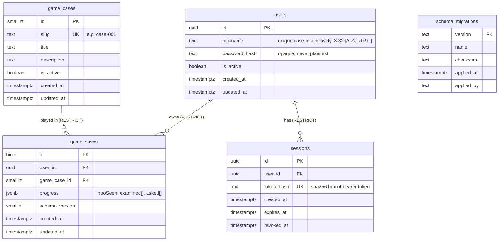

# Schema reference

PostgreSQL 17, schema `public`, UTF-8. Created by `migrations/0001_initial_schema.sql`.
ER diagram source: [`er-diagram.mmd`](er-diagram.mmd).

## Tables

### `users` - player accounts
| Column | Type | Notes |
|---|---|---|
| `id` | `uuid` PK, default `gen_random_uuid()` | Matches frontend `User.id: string` |
| `nickname` | `text` NOT NULL | CHECK `^[A-Za-z0-9_]{3,32}$`; **unique on `lower(nickname)`** (index `users_nickname_lower_key`) |
| `password_hash` | `text` NOT NULL | 1-255 chars, opaque. Never store plaintext |
| `is_active` | `boolean` default `true` | Disable instead of delete (the app role cannot delete users) |
| `created_at`, `updated_at` | `timestamptz` | `updated_at` maintained by trigger |

No e-mail column: the case rules say nickname + password only.

### `game_cases` - case registry
`id smallint` identity PK, `slug` unique (`^[a-z0-9]+(-[a-z0-9]+)*$`), `title`, `description`, `is_active`, timestamps.
Seeded by the migration with `case-001` / "Последний круг". Story content is **not** stored: it is bundled in the frontend.
Adding a case = a new migration with an `INSERT`.

### `game_saves` - progress
| Column | Type | Notes |
|---|---|---|
| `id` | `bigint` identity PK | |
| `user_id` | `uuid` FK -> `users` **RESTRICT** | |
| `game_case_id` | `smallint` FK -> `game_cases` **RESTRICT** | |
| `progress` | `jsonb` NOT NULL | default `{"introSeen": false, "examined": [], "asked": []}` |
| `schema_version` | `smallint` default 1 | Layout version of `progress` |
| `created_at`, `updated_at` | `timestamptz` | |

Constraints: `UNIQUE (user_id, game_case_id)` (one save per user per case - exactly what source shows);
`progress` must be a JSON **object**; if present `introSeen` is boolean, `examined`/`asked` are arrays of **strings**
(`null` is rejected); serialized size <= 64 KiB. Unknown extra keys are allowed (future finale stage).
Index: the unique constraint serves per-user lookups; `game_saves_game_case_id_idx` serves FK checks.
No GIN index on `progress` - nothing queries inside it.

**Valid values (validated by the application, not by the DB, so content changes need no migration):**
`examined` in `no-skid, wreck, barrier, debris, shift-board, fifth-uniform, insulation-tools, vip-box`;
`asked` in `pilot:{friend,envy,race,brakes}`, `mechanic:{custody,count,fifth,alibi}`, `sponsor:{grief,motive,stands,photo}`.

Missing / new / reset saves:
- **No row** = new player. The application answers with the default progress (legacy returned `{}`); the row is created on first save.
- **New**: `save_game_progress()` creates it with defaults filled in.
- **Reset**: `UPDATE ... SET progress = <default>` - this *overwrites* progress irreversibly (no history table, because the source has no reset feature). Take a backup first if that matters.

### `sessions` - server-side sessions
`id uuid` PK, `user_id` FK **RESTRICT**, `token_hash` (unique, 64 lowercase hex = SHA-256 of the opaque bearer token),
`created_at`, `expires_at` (must be > `created_at`), `revoked_at`. Indexes on `user_id` and `expires_at` (purge job).
A session is valid when `revoked_at IS NULL AND expires_at > now()`. Suggested lifetime: 30 days (assumption).
The token itself is never stored: a database leak does not leak usable tokens.

### `schema_migrations` - created by `scripts/migrate.sh`
`version`, `name`, `checksum` (SHA-256 of the file), `applied_at`, `applied_by`. Not accessible to the app role.

## Function
`save_game_progress(p_user_id uuid, p_case_slug text, p_patch jsonb) RETURNS SETOF game_saves`
Atomic upsert in one statement, with **shallow merge** `existing || patch` (same as the frontend's `{...current, ...patch}`;
arrays are replaced, not unioned). Returns 0 rows for an unknown/inactive case. It does **no authorization**: the caller must pass the
user id taken from the validated session, never from request input.

## Deletion rules and data safety
- Every FK is `ON DELETE RESTRICT`: deleting a user/case that has saves or sessions fails instead of silently destroying data.
- The runtime role has **no DELETE** on `users`, `game_saves`, `game_cases` (only on `sessions`, for purging).
- Account removal, if ever needed, is an administrative action done as the migrator role: delete sessions and saves first, deliberately.
- Multi-row changes must use a transaction (`BEGIN ... COMMIT`); single-statement upserts are atomic by themselves.

## Roles and privileges
| Role | Purpose | Rights |
|---|---|---|
| `POSTGRES_SUPERUSER` | bootstrap | superuser; never used by an application |
| `last_lap_migrator` | owner, migrations, backup/restore | owns all objects, no superuser |
| `last_lap_user` (in group `last_lap_app`) | the future backend | `users`: SELECT, INSERT, UPDATE(`password_hash`,`is_active`); `game_cases`: SELECT; `game_saves`: SELECT, INSERT, UPDATE(`progress`,`schema_version`); `sessions`: SELECT, INSERT, DELETE, UPDATE(`revoked_at`); EXECUTE `save_game_progress` |

Database constraints protect data **shape and integrity**. They do not decide *who may do what*: e.g. that user A may only read user B's save
is an authorization rule the backend must enforce (see `INTEGRATION_GUIDE.md`).
